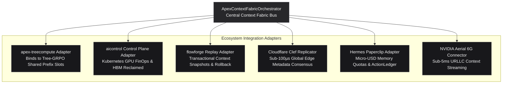

# Enterprise Integration Guide: Apex_ContextFabric

## Integrating TreeCompute, Control Plane, FlowForge, Clef & Paperclip

```
Classification:   Enterprise Infrastructure & Context Storage Integration Specification
Target Frameworks: apex-treecompute • aicontrol • flowforge • Cloudflare Clef • Paperclip
Runtime:          Pure Python Standard Library (Zero External Dependencies)
```

---

## 1. Architectural Overview



---

## 2. Programmatic Python API Quickstart

```python
from apex_contextfabric.orchestrator import ApexContextFabricOrchestrator

# 1. Initialize orchestrator with 32x transform coding target
orchestrator = ApexContextFabricOrchestrator(
    target_compression_ratio=32.0,
    hbm_capacity_mb=80_000.0,
    default_budget_usd=10.00,
)

# 2. Ingest, compress, and store 128k token context trajectory
state = orchestrator.compress_and_store_context(
    session_id="session-enterprise-01",
    token_count=131_072,  # 128k context
    head_count=32,
    head_dim=128,
    model_name="nvidia/nemotron-3-ultra-550b",
)

print("Original Memory   :", f"{state.kvtc_metrics.original_memory_mb:.2f} MB")
print("Compressed Memory :", f"{state.kvtc_metrics.compressed_memory_mb:.2f} MB")
print("Compression Ratio :", f"{state.kvtc_metrics.compression_ratio}x")
print("HBM Memory Saved  :", f"{state.kvtc_metrics.memory_savings_pct}%")
print("ActionLedger SHA  :", state.ledger_sha256)

# 3. Simulate 16-agent collaborative reasoning swarm deduplication
mesh_summary = orchestrator.simulate_swarm_deduplication(
    subagent_count=16,
    shared_prompt_tokens=65_536,
    private_tokens_per_agent=8_192,
)

print("Active Subagents  :", mesh_summary.active_subagents)
print("Swarm Dedupe Ratio:", f"{mesh_summary.deduplication_ratio_pct}%")
print("HBM Reclaimed     :", f"{mesh_summary.hbm_reclaimed_gb:.3f} GB")

# 4. Generate C-Suite Executive Memo
memo_md = orchestrator.generate_executive_markdown_report(state)
print(memo_md)
```

---

## 3. Integration Specifications

### 3.1 Apex_TreeCompute Adapter (`TreeComputePrefixAdapter`)
- **Repository**: [`https://github.com/AAH20/apex-treecompute`](https://github.com/AAH20/apex-treecompute).
- **Functionality**: Binds 32x transform-coded KV blocks directly to Tree-GRPO rollout slots, ensuring that parallel MCTS search branches share common parent attention blocks without redundant GPU memory replication.

### 3.2 Enterprise AI Production Control Plane (`ControlPlaneFinOpsAdapter`)
- **Repository**: [`https://github.com/AAH20/enterprise-ai-production-control-plane`](https://github.com/AAH20/enterprise-ai-production-control-plane) (`aicontrol`).
- **Functionality**: Tracks amortized GPU High-Bandwidth Memory (HBM) dollar savings across Kubernetes DGX SuperPOD clusters.

### 3.3 Enterprise AI Integration Platform (`FlowForgeContextReplayAdapter`)
- **Repository**: [`https://github.com/AAH20/enterprise-ai-integration-platform`](https://github.com/AAH20/enterprise-ai-integration-platform) (`flowforge`).
- **Functionality**: Preserves transactional memory checkpoints before agent tool invocations, allowing deterministic rollback if tool calls fail or hallucinate.

### 3.4 Cloudflare Clef Edge Replicator (`ClefEdgeReplicator`)
- **Protocol**: Replicates content-addressed KV block descriptors across 330+ Cloudflare edge locations with sub-100µs consensus latency.

### 3.5 Hermes Paperclip Adapter (`PaperclipBudgetGovernor`)
- **Functionality**: Enforces micro-USD memory allocation quotas with SHA-256 `ActionLedger` receipts and heartbeat lifecycle tracking.

### 3.6 NVIDIA Aerial 6G Connector (`Aerial6GContextConnector`)
- **Functionality**: Validates sub-5ms Ultra-Reliable Low-Latency Communication (URLLC) streaming SLAs for distributed edge robotics clusters.
